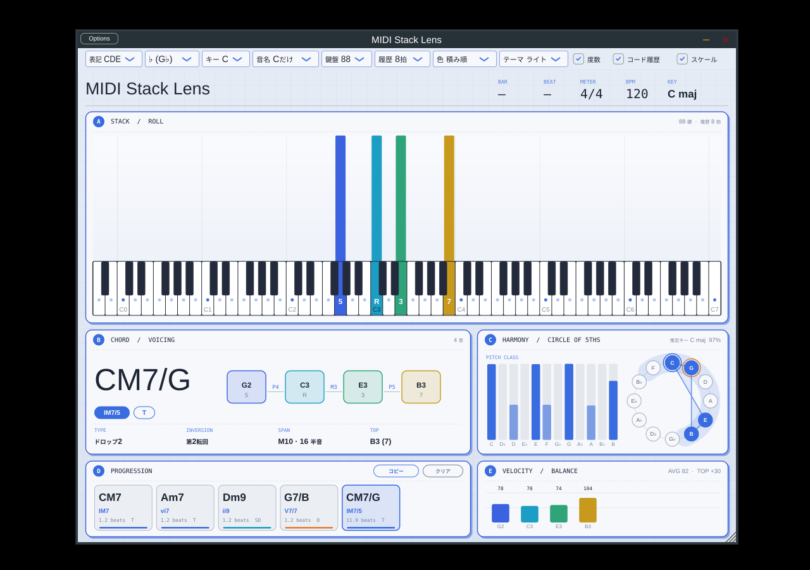

# MIDI Stack Lens

MIDIの積み方(ボイシング)を鍵盤で見るためのVST3。音は出さず、届いたMIDIをそのまま素通しします。



## できること

画面は5つのパネルに分かれています。

| | パネル | 見えるもの |
|---|---|---|
| A | STACK / ROLL | 履歴ロールと鍵盤。押した音が積み上がって、あとから和音の組み方を見返せる |
| B | CHORD / VOICING | コード名、ディグリー(V7 など)と機能(T / SD / D)、低い音から順に並べた積み方と音どうしの音程、型・転回・幅・トップノート |
| C | HARMONY / CIRCLE OF 5THS | 五度圏の上に押さえた音を図形で表示。音名ごとの出現量と、そこから推定したキー |
| D | PROGRESSION | 弾いたコードの履歴。「コピー」で `C \| Am7 \| F \| G7` の形でクリップボードへ |
| E | VELOCITY / BALANCE | 音ごとのベロシティ。平均と、トップノートが他の音よりどれだけ強いか |

- 上の帯に DAW の小節・拍・拍子・BPM と、推定キーを表示(下の線は小節の中の位置)
- ボイシングの型はクローズ / オープン / ドロップ2 / ドロップ3 / スプレッドを判定
- 低い音域で音が近すぎるとき(ローインターバルリミット)は「低音が近い」と出して、該当の音を枠で知らせる
- 推定キーのスケール音を鍵盤に点で表示。スケール外の音はロールで枠が付く(色を「スケール」にすると色分け)
- 鍵盤を離しても、直前の形を薄く残す
- 色は「積み順 / 音名 / 強さ / スケール」、テーマはライト / ダーク
- 押さえた鍵盤の上に度数(R, 3, 5, ♭7, 9 …)、ロールにもコード名が残る
- [namigroove.com/tools/piano](https://www.namigroove.com/tools/piano/) から引き継いだ設定
  - 表記 CDE / ドレミ、♭ / ♯
  - キー(アルトサックスは E♭、テナーは B♭ など。鍵盤の音名とコード名がその楽器の楽譜どおりになる)
  - 鍵盤の音名(Cだけ / 全部 / なし)

履歴の長さは「拍」で決まります。DAW のテンポに合わせて流れる速さが変わります(テンポが取れないときは 120 BPM)。
オクターブ表記は C3 = MIDIノート60 です。

## 録音と動画(MP4)の書き出し

演奏をMIDIで記録して、あとから `.mid` や動画にできます。タイトルの右にあるチップで操作します。

| チップ | はたらき |
|---|---|
| ● 録音 | 録音を始める / 止める。「連動 ON」のときは、DAWの再生を押した瞬間に始まり、停止で自動的に止まる |
| 連動 ON / OFF | OFF にすると、DAWが止まっていても、押した瞬間から録音する(Standalone版や、鍵盤を弾くだけのとき) |
| MIDI | 録音を標準MIDIファイル(.mid)として保存。テンポの変化も入る |
| MP4 | 録音を動画にする。サイズは 横16:9(1920x1080、1280x720)/ 縦9:16(1080x1920、SNS向け)/ 正方形、30 / 60 fps |

- 録音はサンプル数で時間を数えるので、DAWのオフライン書き出し中でもずれません。録音できるのは1回分(次の録音を始めるまで残る)で、DAWのプロジェクトを閉じると消えます。
- 動画は、記録したMIDIから1コマずつ画面を描いて作ります。DAWの再生とは関係ないので、コマ落ちしません。いま画面で選んでいるテーマ・鍵盤の範囲・履歴の長さ・色の付け方で描きます。
- 音は、DAWで書き出したWAVを選ぶと動画に合わせます(選ばなければ無音)。「WAVの頭出し」には、WAVの先頭が録音の頭より何秒前かを入れます。DAWが1小節目から書き出していて、途中から録音したときは、最初に入っている値のままで合います。
- mp4 にまとめる部分は、お使いのPCの **ffmpeg**(無料)を使います。プラグインには入っていません。見つからないときは、場所を選ぶ画面が出ます(Windows: `winget install ffmpeg`、Mac: `brew install ffmpeg`)。

## ダウンロードして使う

**[最新版をダウンロード(Releases)](https://github.com/namigroove/midi-stack-lens/releases/latest)** を開いて、下の「Assets」から自分のOSの zip を選びます。

| OS | ファイル | 入れる場所 |
|---|---|---|
| Windows | `…-Windows-VST3.zip` | 中の `MIDI Stack Lens.vst3` を `C:\Program Files\Common Files\VST3\` へ |
| Mac | `…-macOS-VST3.zip` | 中の `MIDI Stack Lens.vst3` を `~/Library/Audio/Plug-Ins/VST3/` へ |

- 入れたあと、DAW のプラグインを再スキャンしてください。
- Mac で「開けません」と出るときは、ターミナルで `xattr -dr com.apple.quarantine ~/Library/Audio/Plug-Ins/VST3/"MIDI Stack Lens.vst3"` を実行します(署名していないため)。
- 自分でビルドしたい人は、下の「ビルド」へ。

## ビルド

CMake と C++17 のコンパイラがあれば、JUCE は自動で取得されます。

```
cmake -B build -DCMAKE_BUILD_TYPE=Release
cmake --build build --config Release --target MidiStackLens_VST3
ctest --test-dir build -C Release     # コード判定・ボイシング分析・録音の単体テスト
```

- Windows: `build/MidiStackLens_artefacts/Release/VST3/MIDI Stack Lens.vst3` を `C:\Program Files\Common Files\VST3\` へ
- macOS: 同じ場所にできる `.vst3` を `~/Library/Audio/Plug-Ins/VST3/` へ(AU も欲しいときは `-DMSL_BUILD_AU=ON`)
- GitHub に置けば `.github/workflows/build.yml` が Windows と Mac のVST3を自動でビルドします

## 使い方のメモ

- Standalone 版を環境変数 `MSL_DEMO=1` を付けて起動すると、MIDI なしでコードを順に鳴らした状態を表示します(画面の確認用。上の画像もこれで撮っています)。

- DAW ではインストゥルメントとして立ち上げて、MIDIトラックの出力先にするか、見たいトラックのMIDIを送り込みます。
  MIDIはそのまま出力に素通しされます。
- Standalone 版も一緒に作られるので、DAW なしでMIDIキーボードをつないで試せます。
- 動画の書き出しを画面なしで試す: `cmake -B build -DMSL_BUILD_EXPORT_DEMO=ON` でビルドして、`MslExportDemo out.mp4 portrait 30` を実行(ffmpeg が必要。デモの演奏を縦動画にします)。

## コード判定の仕組み

`Source/ChordDetector.cpp` に、コードの型の表(約40種)があります。構成音を12の音名に畳み込み、
全ての音名をルート候補として表と照合します。最低音がルートならコスト0、そうでなければ加点して、
一番コストの小さい名前を採用します(`A C E G` を最低音Cで押さえると `Am7/C` ではなく `C6`、最低音Aなら `Am7`)。
5度の省略は許し、ルートの省略(ルートレス)は判定しません。
名前が付かない押さえ方でも、最低音を基準に度数は出ます。

## 分析の仕組み

`Source/Analysis.cpp` は JUCE に依存しない分析だけのコードです(`tests/analysis_test.cpp` で単体テスト)。

- キー推定: 直近およそ30秒の音名の出現量を、Temperley のキープロファイル(長調・短調 × 12)と照合します。
  別のキーが1.5秒続けて一番らしいときだけ切り替えるので、表示はちらつきません。短いフレーズや転調の直後は外れることがあります。
- ドロップ2 / ドロップ3: 4声で、最低音を1オクターブ上げるとクローズに収まる形を判定します。
- ローインターバルリミット: 隣り合う2音の音程ごとに「これより低いと濁りやすい」目安の高さを持っています。あくまで目安です。

## フォント

画面の文字は「x12y12pxMaruMinya(マルミーニャ)」で統一しています(`assets/x12y12pxMaruMinya.ttf`、作者 hicc 氏。プラグインに埋め込み)。ドット文字なので、太字はありません。
